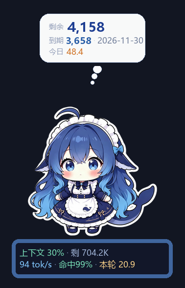
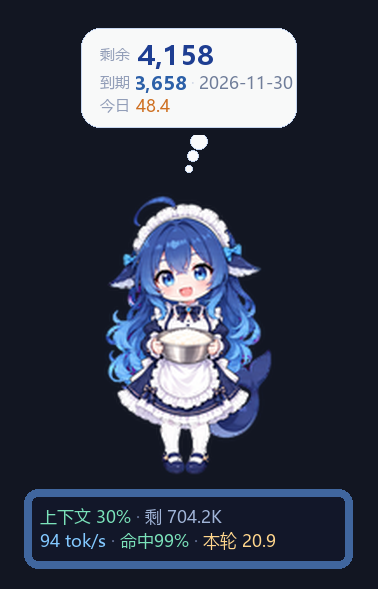
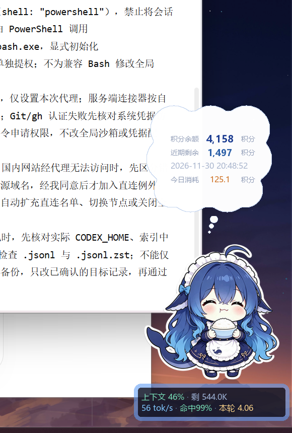

# DeepSeek 鲸鱼娘桌宠 · WorkBuddy 版

一只常驻 Windows 桌面右下角的 Q 版 DeepSeek 鲸鱼娘（社区昵称「蓝色大肥鱼」），
盯着本机 WorkBuddy 的会话，实时报出**今日积分、本轮消耗、上下文余量、输出速率**。

改造自 [`XT-nya/deepseek-dafeiyu-pet`](https://github.com/XT-nya/deepseek-dafeiyu-pet)（MIT），
把数据源从 DeepSeek Harness 换成了 WorkBuddy，并加了一套逐帧动画形态。

> 非官方社区同人项目，与 DeepSeek、腾讯、OpenAI 均无隶属关系。
> **角色贴图为第三方同人素材，CC BY-NC-SA 4.0，仅限非商业使用；动画素材的开放授权尚未确认。**
> 完整授权链、署名义务与免责声明见 [NOTICE.md](NOTICE.md)，代码许可见 [LICENSE](LICENSE)。

## 它能做什么

- 无边框、逐像素透明的置顶窗口：可拖拽抛掷、落地弹跳、自动散步，朝左走自动镜像。
- 三种形态：18 张精细静态差分（默认胸像）、全身立绘、57 帧 / 9 组逐帧动画。
- 只读本机 `workbuddy.db` 与会话 `jsonl`，统计今日积分、本轮消耗、上下文占用与输出速率。
- 通过 WorkBuddy 自带的 WBIPC 本机能力查询真实余额与积分包到期时间，头顶气泡与详情卡随之更新。
- 跟随 WorkBuddy 启停：一条计划任务 + 常驻看门脚本，宿主退出时自动关闭桌宠。
- 没装 WorkBuddy 或读不到数据时，宠物、动画、物理照常工作，只是信息条为空。

## 截图

| 默认胸像 | 逐帧动画 | 实机效果 |
|---|---|---|
|  |  |  |

更多对比与调试图见 [`docs/`](docs/)。截图画面含第三方角色贴图，许可见 [NOTICE.md](NOTICE.md)。

## 快速开始

环境：Windows 10/11 + Python 3.9+（需 Tkinter、Pillow、numpy）。只在本机运行，不需要管理员权限。

1. 克隆本仓库。
2. 双击 `setup.bat`：创建 `tools/venv-tk` 并安装依赖（要求 `python.exe` 在 PATH 中）。
3. 双击 `start-pet.bat` 启动桌宠。
4. 可选：双击 `install-follow.bat` 注册「随 WorkBuddy 启停」的计划任务，用 `uninstall-follow.bat` 撤销。

`start-pet.bat` 会依次尝试项目虚拟环境与本机 Python 运行时；都没找到时，按提示把 `PYW` 改成自己的 `pythonw.exe` 路径即可。本机配置、PID 文件与日志由程序运行时生成，不纳入版本控制。

> 真实余额依赖 WorkBuddy 正在运行且已登录；WBIPC 是宿主开放的本机能力，本项目不修改 WorkBuddy 的安装文件。

## 和上游的区别

| | 上游 | 本版 |
|---|---|---|
| 数据源 | `~/.dsh/sessions/**/*.jsonl.zstd` | `~/.workbuddy/workbuddy.db` + `projects/*/*.jsonl` |
| 口径 | 峰谷计价、折算人民币 | 积分（credit）、上下文占用 |
| 形象 | 18 张静态差分 | 18 张差分 **+** 57 帧逐帧动画（9 组动作） |
| 依赖 | 需要 zstandard | 不需要（只读 jsonl 与 sqlite） |

用量读取本机记录；余额通过 WorkBuddy 自带 WBIPC 本机代理查询真实计费接口。
桌宠不提取云端登录令牌、不读取 Cookie 或 API Key；请求沿用宿主现有登录态和网络配置。

## 隐私与网络行为

- 用量统计全部在本地完成：以只读方式打开 `workbuddy.db`（`mode=ro`）与会话 `jsonl`，不写入、不上传。
- 桌宠自身不直接访问外网。余额查询通过 WorkBuddy 开放的本机 WBIPC v1 通道，由宿主用其现有登录态发起**三个固定只读计费查询**（见下一节及「真实余额如何更新」）。桌宠不读取 Cookie、API Key 或云端登录令牌，不保存握手票据，也不提供任意请求入口。
- 没有第三方统计、遥测或埋点；不收集账号、会话内容或文件内容。
- 宿主未启动、未登录或断网时，保留上次成功数值并标记「未同步」，详情卡显示原因；不发起额外请求。

## 用法

**推荐：跟着 WorkBuddy 一起开**

双击一次 `install-follow.bat`。它会注册一个登录时启动的计划任务
（任务名 `WorkBuddy Pet Whale`），常驻的看门脚本每 3 秒看一眼 WorkBuddy：
开着就把桌宠拉起来，关掉就把桌宠一起关掉。只注册在当前用户名下，
不需要管理员权限，随时用 `uninstall-follow.bat` 撤掉。

做法参考 Codex 的「API 余额小鲸娘」——同样是计划任务 + 常驻看门 + 轮询宿主进程，
只是宿主从 Codex 换成 WorkBuddy，任务名也另起，两者互不影响。

单独启动：双击 `start-pet.bat`。

**日常操作**

1. 右键宠物：换形态、调物理效果、开关信息条模块、改大小。
2. 右键 →「设置积分额度…」：手填三项。
3. 右键 →「从剪贴板同步额度」：也可以完全不填，见下一节。
4. 双击宠物：弹积分包列表（每个包的剩余与到期时间，按到期排序）。
5. 拖拽可以扔出去，落地会弹；走动时朝左会自动镜像。

## 头顶思考泡

采用椭圆白底、细蓝描边和两枚椭圆尾泡，参考「API 余额小鲸娘」的视觉层级，
轮廓使用原创连续贝塞尔曲线。三倍采样缩小，避免拼圆尖角与锯齿；保留默认精细胸像。

- 大号数字：真实剩余积分，保留两位小数。
- 次行：最近到期积分包的剩余；下面是完整到期时间。
- 淡蓝胶囊：今日消耗，保留两位小数。
- 底部：同步状态与上次成功查询时间。失败显示「未同步」，继续保留上次数值。
- 气泡宽度固定在宠物窗口以内，适配 DPI 和较大的余额数字。

双击宠物打开积分包列表，按到期时间排序，最多显示最近六包；右键可以关闭思考泡。

## 真实余额如何更新

启动后自动读取 `~/.workbuddy/wbipc/endpoint.json`，使用 WBIPC v1 双向握手，
调用宿主开放的 `wb.request/http.fetch`。宿主自行附加登录态；桌宠只发送以下固定只读查询：

- `/billing/meter/get-user-resource-summary`：总余额。
- `/billing/meter/get-user-resource-free-packages`：赠送与基础积分包。
- `/billing/meter/get-user-resource-paid-packages`：付费积分包。

积分包按页读取，优先使用精确小数字段。周期套餐按本周期结束时间显示，
空余额、过期组耗尽或无到期信息时会清除旧到期提示。

活跃时每 15 秒查询一次，空闲时每 60 秒查询一次；检测到本机消费变化会提前查询，
两次请求至少间隔 5 秒。右键「立即刷新积分」可主动刷新。由于宿主计费结算有延迟，
这是自动定时同步，并非服务端推送。失败按 15/30/60/120 秒退避；重新登录后自动重连。

未启动、未登录、断网或协议变化时保留上次成功数值，标记「未同步」，
详情卡显示简短原因。剪贴板识别与手填保留作回退；旧剪贴板不会覆盖已同步的真实值。
自动恢复后以接口结果为准。可将 `pet.config.json` 中的 `quota_clipboard` 设为 `false` 关闭监听。

本机 SQLite 读取同时检查主库与 WAL 更新，今日消耗汇总为所有会话优先采用宿主已结算积分。
余额查询独立运行，不阻塞宠物绘制和本机用量采集；没有新增依赖，不修改 WorkBuddy 安装文件。

## 三种形态

右键 →「形态」：

- **胸像 · 静态差分（默认）** — 画质最精细，贴纸风立绘，18 种表情
- **全身立绘 · 静态差分** — 同一套素材的另一组构图
- **逐帧动画 · 57 帧** — 抱饭盆、眨眼摆尾的连续动画，画风偏扁平

颜值优先就用默认的胸像；想看动作用第三项。动画帧来自 8×11 精灵图集，
每帧 192×208，按整组并集 bbox 裁掉空白边后等比适配。

## 数据是怎么读的

- **用量**：`projects/<项目>/<会话id>.jsonl`，每个模型调用一行，
  字段在 `providerData.usage` / `rawUsage`。一轮对话用
  `conversationRequestId` 归组。注意 WorkBuddy 的 `prompt_tokens`
  **含**缓存命中部分，和 DSH 正好相反，混用会把花费算错一个数量级。
- **结算后的积分与上下文**：`workbuddy.db` 的 `session_usage` 表，
  `credit_json` 是宿主算好的每轮积分，`used` / `size` 是上下文占用与窗口。
  只以只读方式打开（`mode=ro`），不会干扰 WorkBuddy。

没装 WorkBuddy 或读不到数据时，宠物本体、动画、物理照常工作，只是信息条为空。

## 目录

```
src/pet.py          主程序（窗口 / 状态机 / 渲染 / 交互）
src/wb_usage.py     WorkBuddy 用量数据源
src/wb_balance.py   WBIPC 真实余额与积分包查询
src/wb_quota.py     剪贴板积分文本解析（回退用）
src/barlib.py       信息条、详情卡、头顶思考泡
src/win_layered.py  Win32 逐像素透明分层窗口
src/physics.py      物理引擎（抛掷 / 弹跳 / 散步 / 撞窗）
src/pricing.py      上游的峰谷计价表，本版已不使用
assets/pet/         18 张静态差分
assets/anim/        57 帧动画（9 组动作）
docs/               运行截图与维护记录
tools/build_anim.py 从图集切帧并生成动画索引
tools/preview_offline.py / preview_bubble.py  不开窗直接出预览图
tools/test_wb_balance.py  离线回归测试
tools/smoke_wb.py   实机冒烟（跑几秒导出真实帧后自动退出）
tools/follow.ps1    看门脚本，跟随 WorkBuddy 启停
tools/install-follow.ps1 / uninstall-follow.ps1  计划任务的注册与移除
```

`src/usage_reader.py` 与 `src/pricing.py` 保留但不再被调用，
`run-selftest.bat` 是上游的 112 项自检，其中用量相关项按 DSH 口径写，本版不适用。
`pet.config.json`、`pet.pid`、`follow.log` 为运行时生成，已在 `.gitignore` 中排除；
`ref/`、`legacy/` 等本机素材与留档目录同样不入库。

## 测试

离线回归（不联网、不读真实账号、不启动窗口）：`python tools\test_wb_balance.py`。
覆盖 WBIPC 双向握手、失败回退、异常数据、分页、精确数值、空额度、WAL 缓存、
贴图更新与 100%–250% DPI 渲染等项。详见 `docs/maintenance-20261102.md` 的验证记录。

## 许可与素材声明

**代码与美术素材是两套独立许可，不要混为一谈：**

| 范围 | 许可 | 商用 |
|---|---|---|
| `src/`、`*.bat`、本仓库原创文档 | MIT（上游 © 2026 XT-nya，本版改动同为 MIT） | ✅ |
| `assets/pet/` 18 张角色差分贴图 | CC BY-NC-SA 4.0（署名 · 非商业 · 相同方式共享） | ❌ |
| `assets/anim/` 57 帧动画 | 上游声明美术资源开放授权**尚未确认** | ❌ 请勿再分发或商用 |
| `docs/` 运行截图（画面含上述贴图） | CC BY-NC-SA 4.0 | ❌ |

角色形象授权链：原创「溟月」（上善无形）→ 女仆装版「鲸鱼娘」（B站 ZipZipPipe）
→ 贴图整理与许可声明（`Vast-Beyond-Space/pet-app`）。逐位署名、CC BY-NC-SA 4.0 的三项义务、
商标边界与下架承诺见 [NOTICE.md](NOTICE.md)。

动画帧来自 [`tqlearning/ai-girl-chatgpt-pets`](https://github.com/tqlearning/ai-girl-chatgpt-pets)，
该仓库声明美术资源的开放授权尚未确认；本项目只做切帧、裁剪与索引，不主张任何权利，
**再分发或商用前请自行核对授权**。思考泡的视觉层级参考了
`MeteorNOX/DeepSeek-Balance-Whale-Widget`，轮廓与绘制代码为独立实现。

本版与 DeepSeek、OpenAI、腾讯均无隶属关系。若权利人认为本仓库内容侵权，
请通过 GitHub Issue 告知，会立即更正署名或下架相关内容。
